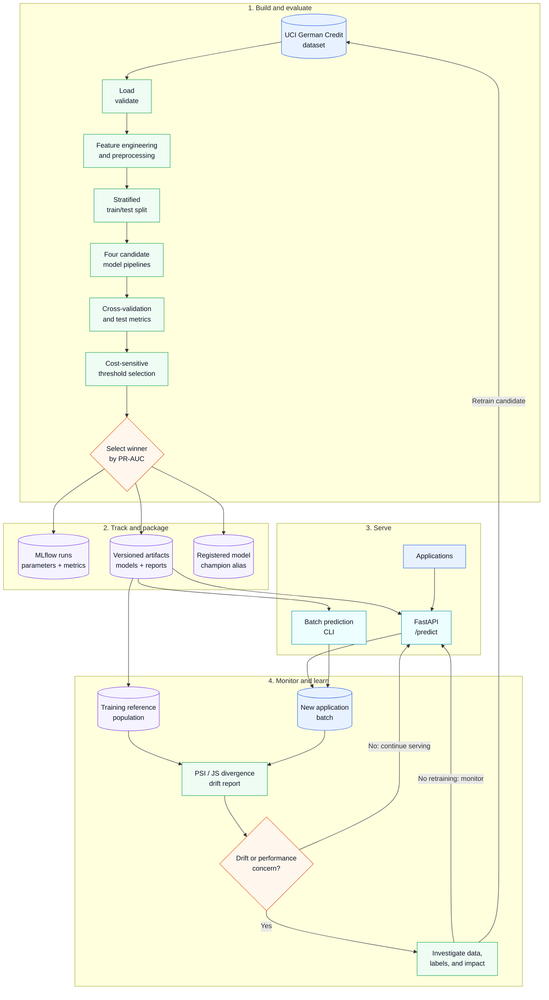

# Credit Risk MLOps Project Guide

This guide explains how the project works from a student's point of view. It
connects the files in the repository to the complete machine-learning
lifecycle:

```text
data -> validation -> features -> models -> evaluation -> tracking
     -> packaging -> serving -> monitoring -> testing
```

The project is educational. It is not a production lending system and must
not be used to make real credit decisions.

## Visual overview of the lifecycle

The diagram below shows how data becomes a serving model and how monitoring
feeds evidence back into the next training decision.



**How to read it:** the upper path creates and evaluates a model; the middle
path records the evidence in MLflow and local artifacts; the serving path uses
the selected artifact; the lower path compares new data with the training
reference and sends only justified retraining requests back to the build
stage.

### One prediction request: from form to decision

```mermaid
flowchart LR
    INPUT["Application data<br/>20 input fields"] --> VALIDATE["Validate request<br/>required fields + ranges"]
    VALIDATE --> FEATURES["Create the same<br/>training features"]
    FEATURES --> MODEL["Selected production<br/>model pipeline"]
    MODEL --> PROB["Bad-credit probability<br/>for example: 0.70"]
    PROB --> THRESHOLD{"Compare with<br/>stored threshold"}
    THRESHOLD -- "probability >= threshold" --> REVIEW["review_or_decline"]
    THRESHOLD -- "probability < threshold" --> APPROVE["approve_or_review"]
    REVIEW --> RESPONSE["JSON response<br/>decision + probability + run ID"]
    APPROVE --> RESPONSE

    classDef input fill:#e8f1ff,stroke:#2563eb,color:#111827
    classDef process fill:#eefcf3,stroke:#16a34a,color:#111827
    classDef decision fill:#fff7ed,stroke:#ea580c,color:#111827
    classDef output fill:#f5f3ff,stroke:#7c3aed,color:#111827
    class INPUT input
    class VALIDATE,FEATURES,MODEL,PROB process
    class THRESHOLD decision
    class REVIEW,APPROVE,RESPONSE output
```



For example, if the trained threshold is `0.45` and the model returns
`0.70`, then `0.70 >= 0.45`, so the API returns `review_or_decline`. The
threshold is learned during training from the configured false-negative and
false-positive costs; it is not necessarily `0.5`.

The actual response looks like:

```json
{
  "bad_credit_probability": 0.07021,
  "decision": "approve_or_review",
  "model_run_id": "20261023T045311Z"
}
```

This diagram is intentionally simpler than the internal Python call path:
students first learn what the service does, then can inspect
`api.py` and `predict.py` to see how each step is implemented. GitHub and many
Markdown viewers render Mermaid diagrams as editable diagrams. If a viewer
does not support Mermaid, the text and JSON example still explain the flow.

## 1. What problem does the project solve?

The project uses the UCI Statlog German Credit dataset to classify an
application as:

- `0`: good credit
- `1`: bad credit

The model does not return only a class label. It returns a probability that an
application is bad credit and applies a decision threshold:

```text
probability >= threshold -> review_or_decline
probability < threshold  -> approve_or_review
```

The threshold is selected using an explicit cost model. Missing a bad-credit
applicant is assigned a higher cost than incorrectly flagging a good-credit
applicant. This demonstrates why the default probability threshold of `0.5`
is not always the right operational decision.

## 2. Repository map

```text
credit-risk-mlops/
|-- .env.example                 Example environment configuration
|-- .github/workflows/ci.yml     Automated lint and test workflow
|-- .dockerignore                Files excluded from Docker build context
|-- Dockerfile                   Application image definition
|-- compose.yaml                 API, MLflow, and training services
|-- configs/default.yaml         Reproducible model and evaluation settings
|-- data/
|   |-- raw/                     Downloaded source dataset
|   `-- reference.csv            Training reference population for monitoring
|-- examples/
|   |-- monitor.csv              Example current population for drift checks
|   `-- request.json             One valid API prediction request
|-- artifacts/                   Versioned local model outputs
|-- mlflow.db                    MLflow SQLite tracking database
|-- mlruns/                      MLflow local artifact store
|-- credit_risk/                 Root import bridge for an uninstalled checkout
|-- src/credit_risk/             Main Python package
|-- tests/                       Unit and API tests
|-- pyproject.toml               Package metadata and dependency configuration
|-- README.md                    Setup and usage instructions
`-- PROJECT_GUIDE.md             This student-oriented guide
```

The `artifacts/`, `mlruns/`, and `mlflow.db` directories are runtime outputs.
They can become large and are not source code. The `src/credit_risk/` package
is the source of truth for application behavior.

## 3. File-by-file explanation

### 3.1 Project configuration

#### `pyproject.toml`

This is the central Python project definition.

It specifies:

- Package name and version
- Minimum Python version
- Runtime dependencies such as FastAPI, pandas, scikit-learn, MLflow, and
  Uvicorn
- Development dependencies such as pytest, Ruff, and HTTPX
- The `credit-risk` console script
- The `src` package-discovery layout
- Pytest and Ruff settings

The `src` layout prevents accidental imports from arbitrary repository files
and is common in installable Python projects. The editable install command is:

```text
python -m pip install -e ".[dev]"
```

#### `configs/default.yaml`

This file stores experiment settings separately from code:

- `random_state`: makes data splitting and model randomness repeatable
- `test_size`: test-set fraction
- `cv_folds`: number of cross-validation folds
- `positive_label`: the bad-credit label
- `false_negative_cost`: cost of missing bad credit
- `false_positive_cost`: cost of flagging good credit
- `drift_psi_threshold`: numeric drift threshold
- `drift_js_threshold`: categorical drift threshold

Keeping these values in configuration makes experiments easier to compare and
repeat.

#### `.env.example`

This documents environment variables for paths, MLflow, the dataset URL, and
Compose ports. Copy it to `.env` when local overrides are needed. Do not put
secrets in source control.

#### `.gitignore` and `.dockerignore`

`.gitignore` excludes generated models, datasets, caches, virtual
environments, and local tracking outputs from Git.

`.dockerignore` prevents development caches, tests, generated artifacts, and
local MLflow data from being sent to the Docker build context. Docker creates a
clean image and runtime data is mounted separately by Compose.

### 3.2 The Python package

#### `src/credit_risk/__init__.py`

Marks the source directory as the `credit_risk` package and provides the
package docstring.

#### `src/credit_risk/__main__.py`

Allows the package to be run as a module:

```text
python -m credit_risk train
```

It delegates to `credit_risk.cli.main`.

#### Root `credit_risk/__init__.py` and `credit_risk/__main__.py`

These small files are a development-checkout bridge. They make
`python -m credit_risk` work directly from the repository root even when the
project has not yet been installed. The production package remains under
`src/credit_risk/`, and Docker installs that package normally.

This is useful for students who clone the project and try a command before
creating a virtual environment. An editable install is still recommended for
local Python development.

#### `src/credit_risk/config.py`

This module defines:

- `Settings`: experiment and model settings
- `RuntimeSettings`: paths, dataset URL, MLflow URI, and registry names
- `load_settings()`: reads YAML configuration
- `load_runtime_settings()`: reads environment overrides
- `write_json()`: writes formatted JSON artifact files
- `configure_logging()`: configures timestamped CLI logs

The separation between `Settings` and `RuntimeSettings` is useful:
experiment choices belong in YAML, while deployment-specific paths and
services belong in environment variables.

Set log verbosity with:

```text
CREDIT_RISK_LOG_LEVEL=DEBUG
```

#### `src/credit_risk/data.py`

This module owns data acquisition and preparation:

1. Downloads the UCI archive if `data/raw/german.data` is absent.
2. Extracts the raw dataset.
3. Reads the whitespace-separated file into a DataFrame.
4. Maps the original target values (`1`, `2`) to (`0`, `1`).
5. Computes a SHA-256 checksum and writes metadata.
6. Validates required columns, target values, and minimum size.
7. Creates a stratified train/test split.
8. Builds the scikit-learn preprocessing transformer.

The preprocessor:

- Median-imputes and scales numeric columns.
- Most-frequent-imputes categorical columns.
- One-hot encodes categorical columns.
- Ignores unknown categories during inference.

Putting preprocessing inside a pipeline is important because the same
transformations are fitted during training and reused during prediction.

#### `src/credit_risk/features.py`

`add_features()` creates domain-inspired features:

- `credit_amount_per_month`
- `age_band`
- `credit_history_duration_ratio`

Feature engineering is called during both training and prediction. Reusing the
same function avoids training-serving skew.

#### `src/credit_risk/models.py`

`build_models()` creates four comparable pipelines:

1. `logistic_baseline`: interpretable linear baseline
2. `random_forest_bagging`: bagging with multiple decision trees
3. `hist_gradient_boosting`: boosting model
4. `stacking_ensemble`: combines logistic, forest, and boosting models

Each model receives its own preprocessor so fitting one model cannot mutate
another model's preprocessing state.

The module also contains a calibration helper. The training flow currently
focuses on threshold selection and does not use that helper as the winner
selection mechanism.

#### `src/credit_risk/evaluate.py`

This module turns model probabilities into evidence for a decision.

- `choose_threshold()` searches thresholds from `0.05` to `0.95` and selects
  the lowest false-negative/false-positive cost.
- `classification_metrics()` calculates ROC-AUC, PR-AUC, balanced accuracy,
  precision, recall, F1, Brier score, confusion matrix, and threshold.
- `cross_validated_metrics()` obtains out-of-fold probabilities using
  stratified cross-validation.
- `permutation_importances()` estimates which input columns most affect ROC-AUC.
- `slice_metrics()` reports recall and positive rate for age and
  personal-status slices.

The slice metrics are diagnostic checks, not a legal or ethical fairness
certification.

#### `src/credit_risk/train.py`

This is the end-to-end training orchestrator:

1. Loads runtime and experiment settings.
2. Loads and validates the dataset.
3. Creates the train/test split.
4. Writes `data/reference.csv` for future monitoring.
5. Builds the four model pipelines.
6. Starts an MLflow comparison run.
7. Cross-validates, fits, evaluates, and saves every model.
8. Selects the winner by test-set PR-AUC.
9. Writes local artifacts and a model card.
10. Logs the selected model to MLflow.
11. Registers the model and assigns the configured alias.
12. Writes `artifacts/production.json`.

Training logs show each major stage and each model's PR-AUC, ROC-AUC, and
decision threshold.

#### `src/credit_risk/predict.py`

This module is shared by the API and CLI. It:

1. Reads `artifacts/production.json`.
2. Locates the selected `.joblib` pipeline.
3. Applies the shared feature engineering function.
4. Calls `predict_proba()`.
5. Applies the stored threshold.
6. Returns probability, decision, and model run ID.

Sharing this code between batch and online inference is an important MLOps
practice.

#### `src/credit_risk/api.py`

This module exposes the FastAPI service:

- `GET /`: service links and status
- `GET /health`: lightweight health check
- `GET /app`: browser dashboard
- `POST /predict`: validates one application and returns one prediction

Pydantic validates ranges such as positive duration, age between 18 and 100,
and installment rate between 1 and 4. Missing production artifacts result in
a clear HTTP 503 response rather than a successful-looking fallback.

#### `src/credit_risk/cli.py`

The CLI provides three commands:

```text
python -m credit_risk train
python -m credit_risk predict --input examples/request.json
python -m credit_risk monitor --config configs/default.yaml --input examples/monitor.csv
```

- `train` runs the full training workflow.
- `predict` accepts one JSON object or a list of objects.
- `monitor` compares a reference CSV with a current CSV.

The CLI initializes logging and prints machine-readable prediction or
monitoring JSON to standard output.

#### `src/credit_risk/monitor.py`

This module detects feature distribution changes:

- PSI for numeric columns
- Jensen-Shannon divergence for categorical columns

The reference data is the training population saved to
`data/reference.csv`. The current data is typically a later batch such as
`examples/monitor.csv`. A drift result includes the metric, value, and Boolean
`drifted` flag.

Drift does not automatically mean the model is wrong. It means the input
population has changed enough to justify investigation, retraining, or
additional validation.

The monitoring decision is intentionally a loop, not an automatic retraining
trigger:

```mermaid
flowchart LR
    REF[("Reference data<br/>data/reference.csv")] --> COMPARE["Compare distributions"]
    BATCH[("Current batch<br/>monitor.csv")] --> COMPARE
    COMPARE --> METRIC{"Column type"}
    METRIC -- Numeric --> PSI["PSI"]
    METRIC -- Categorical --> JS["Jensen-Shannon<br/>divergence"]
    PSI --> THRESHOLD{"Above configured<br/>threshold?"}
    JS --> THRESHOLD
    THRESHOLD -- No --> HEALTHY["No input drift signal<br/>continue monitoring"]
    THRESHOLD -- Yes --> ALERT["Drift signal<br/>investigate"]
    ALERT --> LABELS{"Are outcome labels<br/>available?"}
    LABELS -- No --> COLLECT["Collect labels and<br/>review data source"]
    LABELS -- Yes --> QUALITY["Measure recall, precision,<br/>PR-AUC, calibration"]
    QUALITY --> IMPACT{"Model impact<br/>confirmed?"}
    IMPACT -- No --> HEALTHY
    IMPACT -- Yes --> RETRAIN["Train candidate"]
    RETRAIN --> COMPAREML["Compare candidate<br/>in MLflow"]
    COMPAREML --> APPROVE{"Approved?"}
    APPROVE -- No --> HEALTHY
    APPROVE -- Yes --> PROMOTE["Promote champion<br/>update reference"]

    classDef data fill:#e8f1ff,stroke:#2563eb,color:#111827
    classDef metric fill:#f5f3ff,stroke:#7c3aed,color:#111827
    classDef decision fill:#fff7ed,stroke:#ea580c,color:#111827
    classDef action fill:#eefcf3,stroke:#16a34a,color:#111827
    class REF,BATCH data
    class PSI,JS,COMPARE,QUALITY,RETRAIN,COMPAREML action
    class METRIC,THRESHOLD,LABELS,IMPACT,APPROVE decision
    class HEALTHY,ALERT,COLLECT,PROMOTE metric
```



**Important:** a drift signal is not an automatic retraining command. It is a
reason to investigate the data and, when labels are available, check whether
model quality has actually changed.

For numeric columns the project uses PSI; for categorical columns it uses
Jensen-Shannon divergence. Both thresholds are configurable through
`configs/default.yaml`:

```text
python -m credit_risk monitor \
  --config configs/default.yaml \
  --input examples/monitor.csv
```

#### `src/credit_risk/ui/index.html`

This is a dependency-free browser interface served by FastAPI. It provides a
form for an application, sends a request to `/predict`, and displays the
probability, action band, and model run ID.

### 3.3 Tests and automation

#### `tests/test_api.py`

Tests the root, dashboard, health, and invalid-request endpoints using
FastAPI's test client.

#### `tests/test_evaluate.py`

Tests cost-sensitive threshold selection and required evaluation fields.

#### `tests/test_features.py`

Checks that domain feature formulas produce expected values.

#### `tests/test_monitor.py`

Checks numeric drift, categorical drift, and clear missing-file errors from
the monitoring CLI.

#### `.github/workflows/ci.yml`

GitHub Actions runs on pushes and pull requests. It:

1. Checks out the repository.
2. Installs Python 3.11.
3. Installs development dependencies.
4. Runs Ruff.
5. Runs pytest.

This prevents a change from being merged without passing the project's
automated quality checks.

### 3.4 Container and deployment files

#### `Dockerfile`

The Dockerfile:

1. Starts from Python 3.11 slim.
2. Sets `/app` as the working directory.
3. Copies package metadata, README, source code, and configuration.
4. Installs the package and runtime dependencies.
5. Exposes port 8000.
6. Starts Uvicorn with the FastAPI application.

#### `compose.yaml`

Compose defines three services:

- `api`: serves FastAPI and mounts artifacts read-only.
- `mlflow`: serves the MLflow UI and tracking API on port 5000.
- `trainer`: an optional one-shot training job enabled by the `training`
  profile.

The trainer and MLflow services share the local database and artifact
directories through bind mounts. This makes the results visible on the host
after containers exit.

## 4. End-to-end execution flow

### Training

```text
python -m credit_risk train
        |
        v
load_dataset()
        |
        v
validate + split + feature engineering
        |
        v
build four pipelines
        |
        v
cross-validation + fit + test metrics
        |
        v
choose winner by PR-AUC
        |
        +--> artifacts/<run_id>/*.joblib and JSON reports
        +--> MLflow comparison runs
        +--> MLflow registered model + champion alias
        `--> artifacts/production.json
```

### Online prediction

```text
POST /predict
    -> Pydantic validation
    -> load production.json
    -> load selected pipeline
    -> add_features()
    -> predict_proba()
    -> apply stored threshold
    -> return probability, decision, run ID
```

### Monitoring

```text
data/reference.csv + examples/monitor.csv
              |
              v
          drift_report()
              |
              v
       PSI / JS divergence report
```

## 5. MLflow in this project

MLflow is the experiment-tracking and model-lifecycle component. It is useful
because training is not just about producing a model file. Students need to
know which data, settings, metrics, threshold, and code path produced that
model.

### 5.1 Tracking URI and local storage

The default local tracking store is SQLite:

```text
sqlite:///mlflow.db
```

The database stores MLflow metadata such as experiments, runs, parameters,
metrics, tags, and model-version information. The `mlruns/` directory stores
local run artifacts.

Start the UI locally with:

```text
mlflow ui --backend-store-uri sqlite:///mlflow.db --port 5000 --workers 1
```

Or use the Compose MLflow service:

```text
docker compose up -d mlflow
```

The single worker is intentional for reliable Windows operation.

### 5.2 Experiments

Training uses the experiment:

```text
credit-risk-training
```

An experiment groups related runs so a student can compare multiple training
attempts instead of searching through unrelated records.

### 5.3 Runs and nested runs

The comparison phase creates a parent run for the training attempt and a
nested run for each model family:

```text
parent run
|-- logistic_baseline
|-- random_forest_bagging
|-- hist_gradient_boosting
`-- stacking_ensemble
```

Each model run records:

- Decision threshold
- Cross-validation metrics
- Test metrics
- Serialized model artifact

Nested runs answer a practical question: which candidate model performed best
under the same dataset split and cost assumptions?

### 5.4 Parameters

The parent comparison run records parameters such as:

- Random seed
- Test size
- Cross-validation folds
- False-negative cost
- False-positive cost
- Dataset row count

The registry run records the selected winner and its threshold. Parameters
make an experiment explainable and reproducible.

### 5.5 Metrics

MLflow receives flattened metric names such as:

```text
cv_pr_auc
cv_roc_auc
test_pr_auc
test_recall
test_brier_score
```

The project uses PR-AUC to select the winner. Other metrics remain available
because no single metric describes every operational trade-off:

- ROC-AUC: ranking quality across thresholds
- PR-AUC: useful when the positive class is less common
- Recall: how many bad-credit cases are found
- Precision: how many flagged cases are actually positive
- Brier score: probability calibration quality
- Confusion matrix: counts of operational outcomes

### 5.6 Artifacts

MLflow stores:

- Dataset metadata
- Serialized candidate models
- Metrics and configuration JSON
- Data profile
- Feature importance
- Slice metrics
- Model card

Artifacts let a student inspect the evidence behind a model rather than only
seeing a score in the terminal.

### 5.7 Model logging and registration

The selected winner is logged with `mlflow.sklearn.log_model()` and registered
under:

```text
credit-risk-production
```

The registry gives the selected model an identity separate from a random file
path. The code then assigns the configured alias:

```text
champion
```

An alias is a stable name for the model version currently intended for
serving. The API in this project serves the local `.joblib` artifact described
by `artifacts/production.json`, while MLflow records the corresponding
registered version and alias.

This distinction is educational:

- The local artifact makes the API simple and reliable offline.
- MLflow provides traceability, comparison, and promotion metadata.
- A larger deployment could load the model directly from the MLflow registry.

### 5.8 Why MLflow helps students

Without MLflow, a student might have:

```text
model_final.pkl
model_final_v2.pkl
model_final_really_final.pkl
```

and no reliable answer to:

- Which dataset was used?
- Which threshold was selected?
- Which model performed best?
- What changed between runs?
- Can the selected model be traced back to its metrics?

MLflow supplies a structured answer through runs, parameters, metrics,
artifacts, registered versions, and aliases.

## 6. Local versus Docker execution

### Local Python

Use local Python when actively editing and debugging source code:

```text
python -m pip install -e ".[dev]"
python -m credit_risk train
```

### Docker Compose

Use Docker when validating a clean, reproducible application environment:

```text
docker compose build
docker compose --profile training run --rm trainer
docker compose up -d api mlflow
```

Docker runs Python and dependencies inside containers. The generated artifacts
remain in the repository through Compose bind mounts.

Do not run both API workflows on the same ports at the same time.

## 7. Student learning path

1. Run the Docker workflow and open the dashboard.
2. Inspect `artifacts/<run_id>/metrics.json`.
3. Open MLflow and compare the nested model runs.
4. Change one value in `configs/default.yaml`.
5. Retrain and compare the new run with the previous run.
6. Inspect `feature_importance.json` and `slice_metrics.json`.
7. Modify `examples/monitor.csv` and run drift monitoring.
8. Add a test for the new behavior.
9. Run Ruff and pytest.
10. Review the model card and limitations before discussing real-world use.

Useful experiments include:

- Increase the false-negative cost and observe threshold changes.
- Compare PR-AUC with recall and precision.
- Change the test size and discuss comparability.
- Add a feature and test whether it improves validation metrics.
- Create a shifted monitoring sample and observe PSI or JS divergence.
- Add an API validation rule and test its HTTP 422 response.

## 8. Generated outputs to inspect

After training, inspect:

```text
artifacts/
`-- <run_id>/
    |-- logistic_baseline.joblib
    |-- random_forest_bagging.joblib
    |-- hist_gradient_boosting.joblib
    |-- stacking_ensemble.joblib
    |-- metrics.json
    |-- config.json
    |-- data_profile.json
    |-- feature_importance.json
    |-- slice_metrics.json
    `-- model_card.md
```

The top-level `artifacts/production.json` identifies the selected model,
threshold, run ID, MLflow model name, alias, and registered version.

## 9. Important limitations

- The dataset is small, old, and encoded.
- The model is not validated for real lending.
- Fairness-oriented slices are diagnostics, not fairness certification.
- Drift detection signals distribution change; it does not prove performance
  degradation.
- Local SQLite and filesystem artifacts are suitable for teaching, not
  high-availability production.
- The API has no authentication or authorization.
- Real deployments require governance, privacy controls, monitoring,
  approval, auditability, and domain/legal review.
